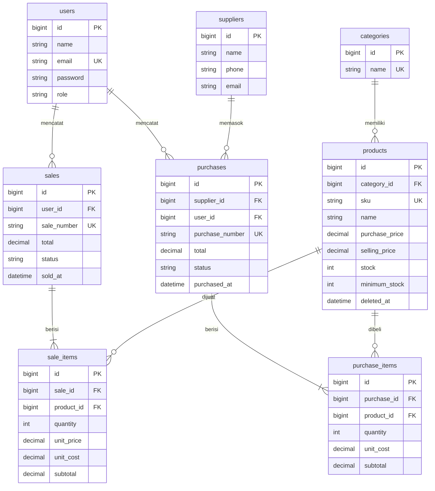
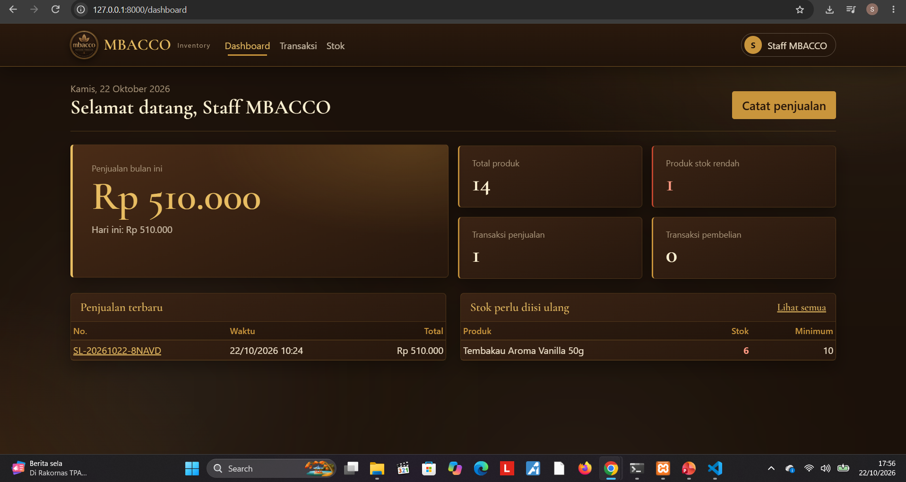
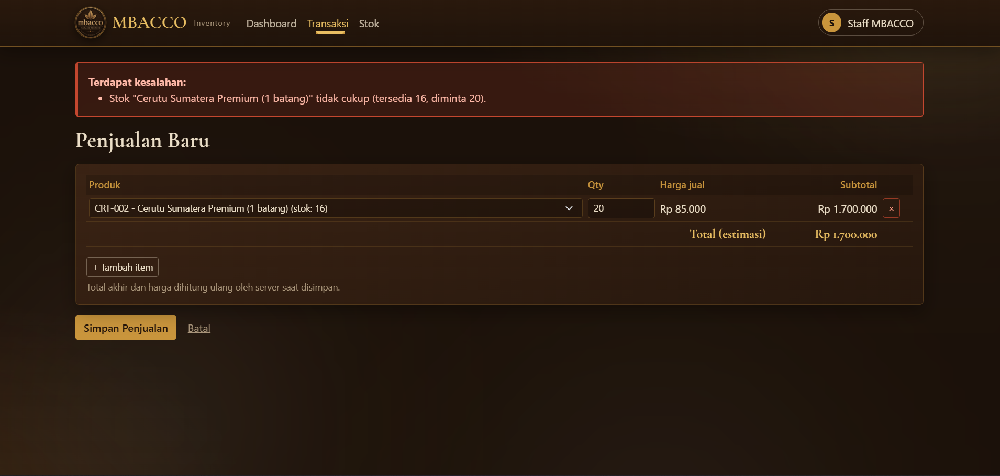
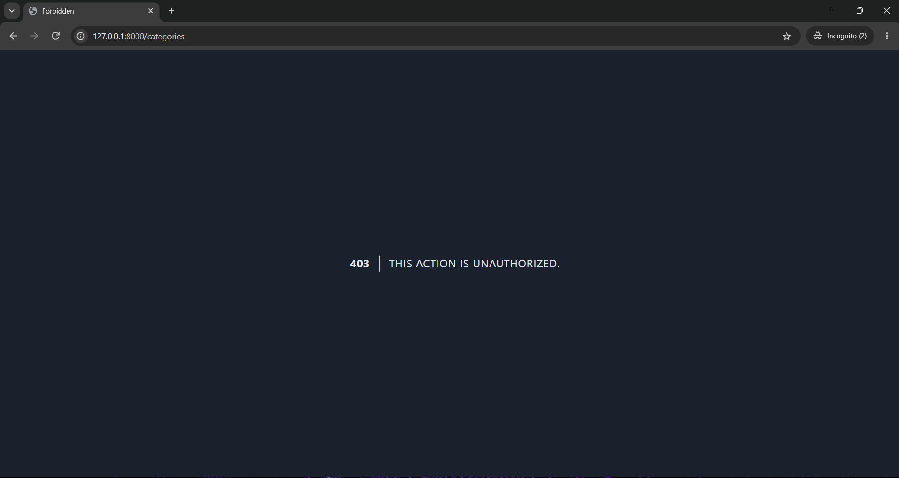
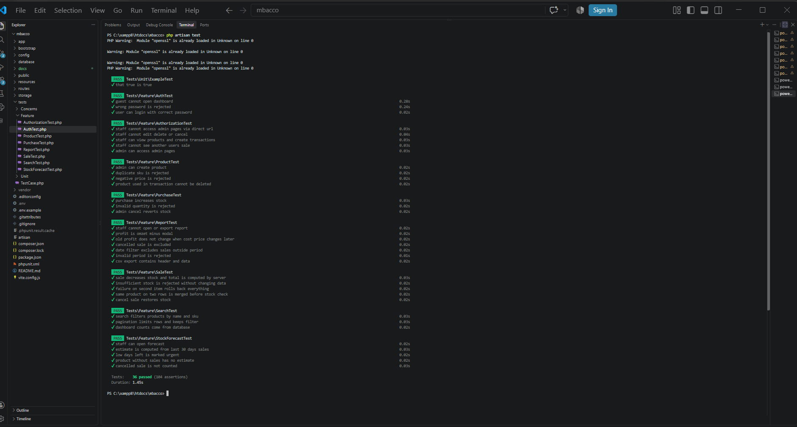

# MBACCO – Inventory & Sales Management System

Aplikasi manajemen stok dan penjualan berbasis **Laravel + MySQL** (UTS Web Programming 2 – Integrated Laravel Project).

## 1. Project Overview
Sistem untuk toko tembakau **MBACCO** (instagram.com/mbacco.id): mengelola kategori, produk, pemasok, pembelian (stock-in), dan penjualan.
Stok berubah otomatis dan konsisten saat transaksi berhasil. Ada dua role: **Admin/Owner** dan **Staff**.

## 2. Requirements
- PHP >= 8.2 (ekstensi: mbstring, xml, pdo_mysql, ctype, json)
- Composer 2
- MySQL / MariaDB
- Laravel 11 atau 12
- Tidak perlu Node/npm: tampilan memakai Bootstrap 5 via CDN (butuh internet saat membuka halaman)

## 3. Installation
Repository ini berisi **lapisan aplikasi** (models, controllers, views, migrations, seeders, tests).
Pasang di atas project Laravel baru:

```bash
composer create-project laravel/laravel inventory-sales
cd inventory-sales
# salin isi folder paket ini ke root project (timpa file bila diminta):
#   app/  database/  resources/  routes/  tests/  README.md
```

## 4. Environment Setup
Edit `.env` (file ini jangan di-commit; commit hanya `.env.example`):

```env
DB_CONNECTION=mysql
DB_HOST=127.0.0.1
DB_PORT=3306
DB_DATABASE=inventory_sales
DB_USERNAME=root
DB_PASSWORD=
```
Buat database kosong `inventory_sales`, lalu pastikan `APP_KEY` terisi (`php artisan key:generate`).

## 5. Migration & Seeding
```bash
php artisan migrate --seed      # atau: php artisan migrate:fresh --seed
php artisan serve
```
Buka http://127.0.0.1:8000

## 6. Demo Account
| Role  | Email             | Password      |
|-------|-------------------|---------------|
| Admin | admin@example.com | password123   |
| Staff | staff@example.com | password123   |

(Akun fiktif untuk demo — bukan kredensial asli.)

## 7. Features
| Modul | Admin | Staff |
|---|---|---|
| Login / logout, password hash, route terlindungi | ✔ | ✔ |
| Kategori, Pemasok (CRUD) | ✔ | ✘ |
| Produk (CRUD) | ✔ | hanya lihat |
| Pengguna & role | ✔ | ✘ |
| Pembelian / stock-in (multi item) | ✔ semua | ✔ miliknya |
| Penjualan (multi item) | ✔ semua | ✔ miliknya |
| Pembatalan transaksi (stok dipulihkan) | ✔ | ✘ |
| Dashboard (agregat dari DB), daftar stok rendah | ✔ | ✔ (angka miliknya) |
| Search SKU/nama, filter kategori/tanggal/status, pagination | ✔ | ✔ |

Business rules yang diterapkan:
- SKU unik (validasi **dan** unique index database).
- Kuantitas > 0, harga >= 0, divalidasi server.
- Penjualan tidak boleh melebihi stok; stok hanya berubah setelah transaksi sukses.
- Total & harga dihitung server dari database, bukan dari input browser.
- Header + item + perubahan stok disimpan dalam satu `DB::transaction` (rollback bila ada yang gagal).
- Baris produk dikunci `lockForUpdate()` untuk mencegah overselling pada transaksi bersamaan.
- Transaksi tidak diedit; hanya bisa dibatalkan (stok dipulihkan, pembatalan ganda ditolak).
- Pembatalan **pembelian** ditolak bila stok saat ini sudah lebih kecil dari kuantitas pembelian (stok tak boleh negatif).
- Produk yang sudah dipakai transaksi tidak dapat dihapus; produk lain di-*soft delete*.
- Kategori/pemasok/pengguna yang masih dipakai tidak dapat dihapus (FK `restrictOnDelete` + pengecekan).

## ERD


### Penjelasan relasi Eloquent
- `hasMany` ada di sisi "satu" (Category → banyak Product); `belongsTo` di sisi "banyak" (Product → satu Category).
- **Foreign key berada di tabel detail/anak** (`products.category_id`, `sale_items.sale_id`) karena satu baris induk dipakai banyak baris anak; menyimpan banyak id di induk melanggar normalisasi.
- Daftar produk memakai `Product::with('category')` untuk menghindari N+1 query.

## Fitur tambahan: Laporan Laba & Estimasi Stok
- **Laporan laba** (`/reports`, khusus admin): omzet, modal, laba kotor, margin, laba per hari, produk paling menguntungkan, filter tanggal, dan ekspor CSV.
  Laba = subtotal penjualan - (qty x `unit_cost`). Kolom `sale_items.unit_cost` menyimpan harga modal *saat transaksi terjadi*
  (snapshot), sehingga laporan lama tidak berubah jika harga beli produk diubah kemudian.
- **Estimasi stok habis** (`/stock-forecast`, admin dan staff): perkiraan hari sampai stok habis = stok / rata-rata terjual per hari (30 hari terakhir),
  plus saran jumlah beli agar cukup 30 hari. Ini hitungan sederhana, bukan AI. Transaksi yang dibatalkan tidak dihitung.
- Setelah menyalin file baru ke project yang sudah berjalan, cukup jalankan `php artisan migrate` (tanpa `fresh`) agar data tidak hilang.

## 8. Known Limitations
- Penomoran transaksi memakai kode acak unik (bukan urut).
- Tidak ada laporan ekspor (PDF/Excel).
- Tidak ada pengembalian sebagian (partial return); hanya pembatalan penuh.
- Bootstrap dimuat via CDN sehingga perlu koneksi internet.
- Belum diuji beban pada transaksi paralel sungguhan (mekanisme `lockForUpdate` dijelaskan di bawah).

---

## Testing
```bash
php artisan test
```
Test memakai database SQLite in-memory bawaan `phpunit.xml` Laravel 11/12 (tidak menyentuh MySQL).

| Skenario (slide UTS) | Test |
|---|---|
| Guest tidak bisa buka dashboard; password salah ditolak | `AuthTest` |
| SKU duplikat & harga negatif ditolak | `ProductTest` |
| Pembelian menambah stok | `PurchaseTest::test_purchase_increases_stock` |
| Penjualan mengurangi stok; total dihitung server | `SaleTest::test_sale_decreases_stock...` |
| Stok tidak cukup ditolak tanpa mengubah data | `SaleTest::test_insufficient_stock...` |
| Atomicity / rollback jika satu item gagal | `SaleTest::test_failure_on_second_item_rolls_back_everything` |
| Staff tidak bisa akses fungsi Admin lewat URL | `AuthorizationTest` |
| Filter & pagination | `SearchTest` |
| Laporan laba, snapshot modal, filter tanggal, CSV, akses admin | `ReportTest` |
| Estimasi stok habis dan saran beli | `StockForecastTest` |

> Tempel output `php artisan test` dan screenshot halaman di folder `docs/` sebagai bukti pengujian.

## Catatan untuk Code Ownership Interview
| Pertanyaan | Jawaban singkat & lokasi kode |
|---|---|
| Mengapa `Sale` hasMany `SaleItem`? | Satu transaksi berisi banyak item; FK `sale_id` ada di `sale_items`. `app/Models/Sale.php` |
| Di mana stok dijaga agar tidak negatif? | Cek `$product->stock < $qty` di `SaleService::create` + kolom `unsignedInteger` di migration. |
| Mengapa total dihitung di server? | Input browser bisa dimanipulasi. Harga dibaca dari tabel `products` di `SaleService`. |
| Risiko mengurangi stok di luar `DB::transaction`? | Bila langkah berikutnya gagal, stok sudah berubah tapi transaksi tidak tercatat (data tidak konsisten). |
| Mencegah Staff akses fungsi Admin lewat URL? | Middleware `can:admin` (Gate di `AppServiceProvider`) pada `routes/web.php` + `authorize()` di `ProductRequest`. |
| Dua penjualan hampir bersamaan pada produk yang sama? | `lockForUpdate()` mengunci baris produk; transaksi kedua menunggu lalu membaca stok terbaru. |
| SKU unik & peran constraint DB? | `Rule::unique` memberi pesan ramah; unique index di migration melindungi dari race condition. |
| Ubah aturan minimum stock? | Definisi "rendah" ada di `Product::isLowStock()` dan `whereColumn('stock','<=','minimum_stock')` (Dashboard & `lowStock`). |

## Struktur kode
```
app/Models                  8 model + relasi Eloquent
app/Http/Controllers        Auth, Dashboard, Category, Supplier, Product, Purchase, Sale, User
app/Http/Requests           ProductRequest, SaleRequest, PurchaseRequest
app/Services                SaleService, PurchaseService  (business logic transaksi)
app/Providers               AppServiceProvider (Gate 'admin', pagination Bootstrap)
database/migrations         skema + FK + index
database/seeders            kategori, produk, pemasok, akun demo
routes/web.php              named routes + middleware auth / can:admin
resources/views             layout reusable + halaman Blade
tests/Feature               test scenario minimum
```## Screenshot

### Dashboard

Ringkasan penjualan, jumlah produk, dan stok rendah. Semua angka dihitung dari database.

### Penjualan ditolak karena stok tidak cukup

Sistem menolak penjualan yang melebihi stok, dan data tidak berubah sama sekali.

### Staff ditolak mengakses halaman admin

Staff yang membuka halaman admin lewat URL langsung mendapat 403.

### Hasil pengujian

Hasil `php artisan test`: 36 test lulus.